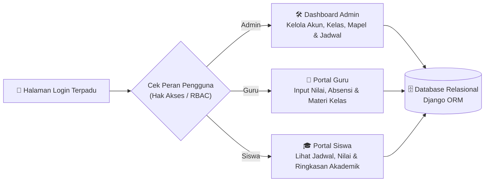

<!-- HERO BANNER -->
<div align="center">
  
</div>

<div align="center">

[](https://www.python.org/)
[](https://www.djangoproject.com/)
[](https://developer.mozilla.org/)
[](https://developer.mozilla.org/)
[](https://www.sqlite.org/)

<br />

**[Alur Sistem](#alur-sistem-berbasis-peran)** · **[Fitur Utama](#fitur-utama-berdasarkan-peran)** · **[Instalasi Lokal](#cara-menjalankan-di-lokal)** · **[Laporkan Bug](https://github.com/abdulgani89/SistemAkademikSiswa/issues)**

</div>

---

## Gambaran Umum

**Sistem Akademik Siswa** adalah aplikasi web *full-stack* berbasis **Django** untuk memusatkan pengelolaan administrasi akademik sekolah. Sistem ini memisahkan antarmuka dan alur kerja ke dalam tiga peran pengguna—**Administrator**, **Guru**, dan **Siswa**—agar pengelolaan data lebih aman dan terstruktur.

> [!IMPORTANT]
> **Hak Akses Berbasis Peran (RBAC):** Setiap pengguna yang masuk otomatis diarahkan ke *dashboard* sesuai perannya masing-masing, sehingga mencegah perubahan data nilai, jadwal, atau data induk akademik secara tidak sah.

---

## Tampilan Antarmuka

<div align="center">
  <table>
    <tr>
      <td align="center"><b>1. Dashboard Administrator</b></td>
      <td align="center"><b>2. Portal Guru</b></td>
      <td align="center"><b>3. Portal Siswa</b></td>
    </tr>
    <tr>
      <td align="center">
        
      </td>
      <td align="center">
        
      </td>
      <td align="center">
        
      </td>
    </tr>
  </table>
  <sub><i>Tampilan antarmuka khusus untuk pengelolaan administrasi, pengajaran, dan pemantauan akademik siswa</i></sub>
</div>

---

## Alur Sistem Berbasis Peran



---

## Fitur Utama Berdasarkan Peran

| Peran | Tanggung Jawab & Modul Utama |
| :--- | :--- |
| **Administrator** | CRUD lengkap untuk akun siswa dan guru, pengaturan kelas, mata pelajaran, tahun ajaran, serta pengawasan data sistem. |
| **Guru** | Mengakses kelas yang diampu, menginput dan memperbarui nilai siswa, serta memantau perkembangan akademik kelas. |
| **Siswa** | Melihat profil pribadi, jadwal pelajaran, daftar mata pelajaran, dan rekap nilai akademik secara langsung. |

*(Sesuaikan rincian fitur di tabel atas jika di proyekmu ada modul tambahan seperti absensi harian, pengumuman sekolah, atau cetak rapor PDF.)*

---

## Teknologi yang Digunakan

<div align="center">
  
</div>

- **Backend & ORM:** Python, Django
- **Frontend:** Django Templates (HTML5, CSS3)
- **Autentikasi:** Sistem autentikasi bawaan Django dengan pemisahan rute berbasis peran
- **Database:** SQLite (bawaan untuk pengembangan lokal; siap dimigrasi ke PostgreSQL)

---

## Cara Menjalankan di Lokal

### 1. Clone Repositori & Buat Virtual Environment

```bash
git clone [https://github.com/abdulgani89/SistemAkademikSiswa.git](https://github.com/abdulgani89/SistemAkademikSiswa.git)
cd SistemAkademikSiswa

# Buat virtual environment
python -m venv .venv

# Aktifkan di Windows (PowerShell)
.venv\Scripts\activate

# Aktifkan di macOS / Linux
source .venv/bin/activate
```

### 2. Instal Dependensi & Konfigurasi Environment

```bash
pip install -r requirements.txt
```

Salin file `.env.example` menjadi `.env`, lalu isi konfigurasi lokal berikut:

```env
SECRET_KEY=isi-dengan-django-secret-key-kamu
DEBUG=True
```

### 3. Jalankan Migrasi Database & Server Lokal

```bash
python manage.py migrate
python manage.py createsuperuser
python manage.py runserver
```

Buka `http://127.0.0.1:8000` di browser untuk mengakses aplikasi.

<details>
<summary><b>📂 Klik untuk melihat Struktur Proyek</b></summary>

```text
sistem-akademik-siswa/
├── config/                 # Konfigurasi proyek Django & URL utama (sesuaikan nama foldermu)
├── apps/                   # Aplikasi Django (accounts, academics, grades, dll.)
├── templates/              # Template HTML dikelompokkan per peran (admin, guru, siswa)
├── static/                 # File CSS, skrip, dan aset statis
├── docs/                   # Screenshot antarmuka untuk dokumentasi README
├── manage.py
├── requirements.txt        # Daftar dependensi Python
├── .env.example            # Template variabel environment
└── README.md
```

</details>

---

## Pengembang

<div align="center">

**Muhamad Abdul Gani**

[](https://github.com/abdulgani89)
[](https://gamasrent.vercel.app)


</div>
